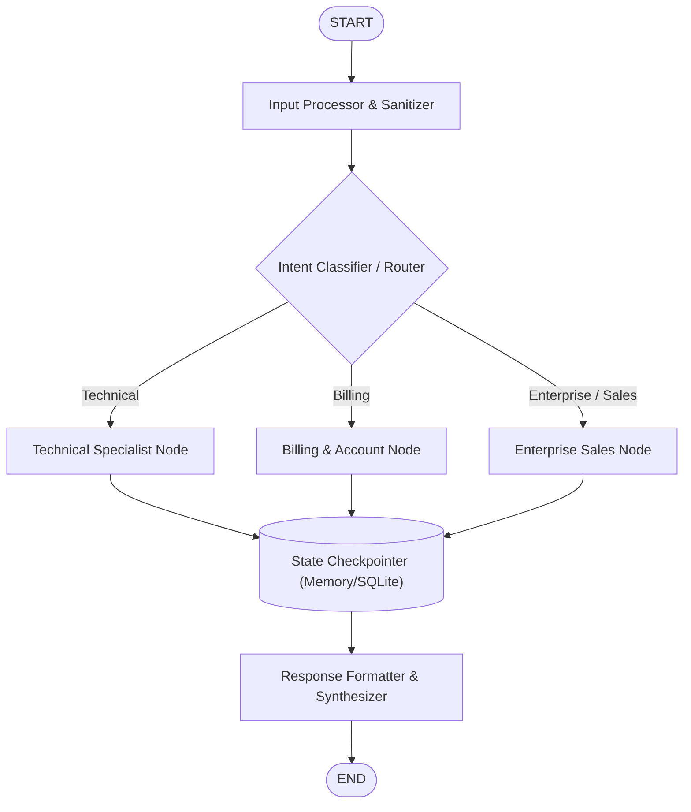

# AgentGraph 🚀

**Next-Generation Stateful Multi-Agent AI Orchestration Engine**

[](https://www.python.org/)
[](LICENSE)
[](https://github.com/yxhyxalikhan-dev)
[]()

AgentGraph is a high-performance orchestration framework designed for building, executing, and monitoring **stateful, cyclic, and multi-agent AI systems**. It provides fine-grained control over multi-step LLM workflows with durable execution, persistent memory checkpoints, and dynamic conditional routing.

---

## 🌟 Key Features

- 🔄 **Graph-Based Control Flow**: Construct complex execution DAGs and cyclic multi-agent loops with typed states.
- 💾 **Durable State & Checkpointing**: Built-in persistence layers with `MemorySaver`, `SqliteSaver`, and `PostgresSaver`.
- 🔀 **Conditional Branching & Routers**: Dynamic runtime routing based on state evaluation and agent decisions.
- 👤 **Human-in-the-Loop Oversight**: Pause execution, inspect state snapshots, update variables, and resume gracefully.
- ⚡ **Async-First & High Throughput**: Native asynchronous support and streaming for tokens and intermediate states.
- 🤖 **Multi-Agent Collaboration**: Orchestrate hierarchical agent networks (Supervisors, Workers, Tools).

---

## 🏗️ Architecture & Execution Flow



---

## 🚀 Quick Start

### 1. Prerequisites
- Python 3.10, 3.11, or 3.12
- [uv](https://github.com/astral-sh/uv) (recommended) or standard `pip` / `venv`

### 2. Installation & Environment Setup

Clone the repository and set up a virtual environment:

```bash
git clone https://github.com/yxhyxalikhan-dev/AgentGraph.git
cd AgentGraph

# Create and activate virtual environment
uv venv --python python3.12
source .venv/bin/activate

# Install core engine in editable mode
uv pip install -e libs/checkpoint -e libs/checkpoint-sqlite -e libs/prebuilt -e libs/langgraph
```

---

## 💡 Code Examples

### 1. Minimal Graph Execution

```python
from typing import TypedDict
from langgraph.graph import StateGraph, START, END

class AgentState(TypedDict):
    message: str

def greeting_node(state: AgentState) -> dict:
    return {"message": state["message"] + " -> Processed by AgentGraph"}

# Build Graph
builder = StateGraph(AgentState)
builder.add_node("greeting", greeting_node)
builder.add_edge(START, "greeting")
builder.add_edge("greeting", END)

# Compile & Run
app = builder.compile()
result = app.invoke({"message": "Hello Agent"})
print(result["message"])
```

### 2. Multi-Turn Session with Checkpointing

```python
from typing import Annotated, TypedDict
import operator
from langgraph.graph import StateGraph, START, END
from langgraph.checkpoint.memory import MemorySaver

class ConversationState(TypedDict):
    messages: Annotated[list[str], operator.add]

def chat_node(state: ConversationState) -> dict:
    reply = f"Agent reply to '{state['messages'][-1]}'"
    return {"messages": [reply]}

checkpointer = MemorySaver()
builder = StateGraph(ConversationState)
builder.add_node("chat", chat_node)
builder.add_edge(START, "chat")
builder.add_edge("chat", END)

app = builder.compile(checkpointer=checkpointer)

# Sessions are persisted by thread_id
config = {"configurable": {"thread_id": "session-101"}}
app.invoke({"messages": ["First user message"]}, config=config)
res = app.invoke({"messages": ["Second message"]}, config=config)
print("Conversation History:", res["messages"])
```

---

## 📁 Repository Structure

```
AgentGraph/
├── libs/
│   ├── langgraph/            # Core Graph runtime & Pregel engine
│   ├── checkpoint/           # Checkpointer interfaces & in-memory store
│   ├── checkpoint-sqlite/    # Persistent SQLite checkpointer
│   ├── checkpoint-postgres/  # Scalable PostgreSQL checkpointer
│   ├── prebuilt/             # Prebuilt components (ToolNode, React agents)
│   └── sdk-py/               # Python Client SDK
├── examples/
│   ├── 01_quickstart.py           # Core graph execution example
│   ├── 02_conditional_routing.py   # Intent-based dynamic branching
│   ├── 03_persistent_memory.py     # Checkpointer state persistence
│   └── 04_sales_agent_team.py      # Multi-agent B2B lead qualification
├── Makefile                  # Build and testing targets
└── README.md                 # Project documentation
```

---

## 🧪 Running the Examples

Run any of the included examples directly using the pre-configured virtual environment:

```bash
# Basic Graph
python examples/01_quickstart.py

# Dynamic Router
python examples/02_conditional_routing.py

# Checkpointed Memory
python examples/03_persistent_memory.py

# Multi-Agent Sales Pipeline
python examples/04_sales_agent_team.py
```

---

## 👤 Author & Maintainer

**Yahya Ali Khan**
- GitHub: [@yxhyxalikhan-dev](https://github.com/yxhyxalikhan-dev)
- Email: yxhyxalikhan@gmail.com

---

## 📄 License

This project is open-source and distributed under the terms of the [MIT License](LICENSE).
